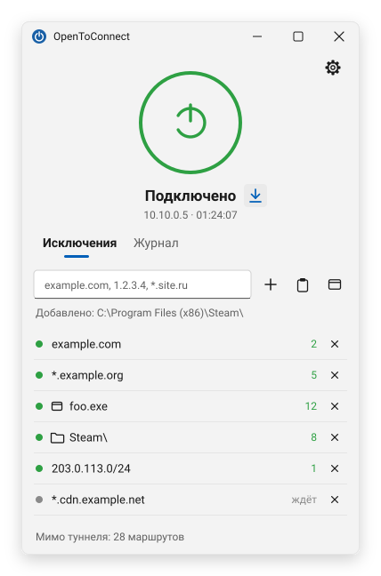
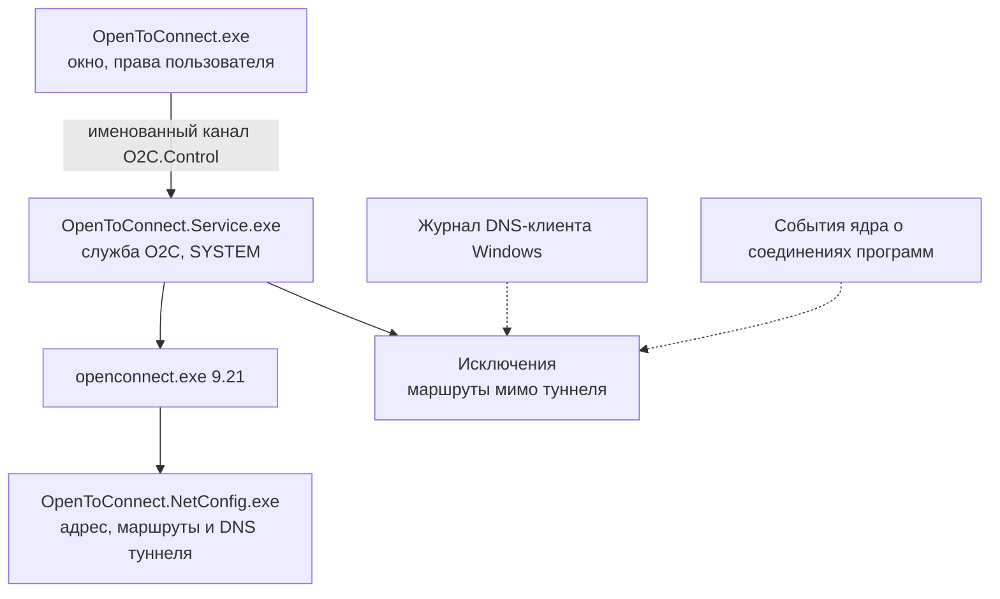

# OpenToConnect

**Windows-клиент для серверов, совместимых с OpenConnect, с исключениями из туннеля по адресам, доменам и программам**

[**Скачать MSI**](https://github.com/Kagaris44/O2C/releases/latest) · [Возможности](#возможности) · [Установка](#установка) · [Исключения](#исключения-из-туннеля) · [Изменения](CHANGELOG.md)

<picture>
  <source media="(prefers-color-scheme: dark)" srcset="docs/images/window-dark.svg">
  
</picture>

*A Windows client for OpenConnect-compatible servers (AnyConnect/ocserv, GlobalProtect, Pulse, F5, Fortinet, Array): a system service, a compact tray UI and split-tunnel exclusions by IP, subnet, domain, `*.domain` mask, by program and for all Russian networks (on demand). Documentation is in Russian.*

## Возможности

| | |
|---|---|
| **Протоколы OpenConnect** | AnyConnect-совместимые серверы (в том числе ocserv), GlobalProtect, Pulse/Juniper, F5, Fortinet, Array |
| **Исключения из туннеля** | IP-адреса, подсети, домены, маски `*.example.com`, программы и папки, все российские сети одной записью. Применяются сразу, без переподключения |
| **Окно без прав администратора** | Всё, что требует прав (адаптер, маршруты, DNS), делает служба Windows; подключение не рвётся при закрытии окна |
| **Переподключение** | Сам переподключается при обрыве; при неверном пароле не повторяет попытки, чтобы не заблокировать учётную запись |
| **DNS этого компьютера** | По умолчанию имена разрешает DNS компьютера; DNS сервера включается галочкой |
| **Компактное окно** | Значок в области уведомлений, светлая и тёмная тема по системе |
| **Один файл MSI** | Установка одним файлом; окно само сообщает о новой версии и обновляет программу |

## Установка

1. Скачайте `OpenToConnect-<версия>.msi` со страницы [последнего релиза](https://github.com/Kagaris44/O2C/releases/latest), запустите и подтвердите запрос прав администратора.
2. В открывшемся окне нажмите шестерёнку, укажите сервер, логин и пароль, нажмите «Сохранить».
3. Вернитесь назад и нажмите большую круглую кнопку.

> [!NOTE]
> Установщик пока не подписан цифровой подписью, поэтому Windows SmartScreen может показать предупреждение. Сверьте SHA-256 файла с указанным на странице релиза.

> [!TIP]
> Если у сервера самоподписанный сертификат, при первом подключении окно покажет его отпечаток и кнопку «Доверять». Нажимайте её, только если отпечаток подтвердил администратор сервера.

О новой версии окно сообщает само: справа от надписи состояния появляется значок загрузки. Проверить вручную можно в настройках («Проверить обновления») или в меню значка в области уведомлений; автоматическую проверку там же можно выключить. Новая версия ставится поверх старой, настройки сохраняются. Удаление — через «Параметры → Приложения»; настройки и журналы в `C:\ProgramData\OpenToConnect` при этом остаются.

Требования: Windows 10 версии 2004 или новее (x64), Windows 11.

## Исключения из туннеля

При подключении трафик идёт так, как задал сервер: весь через туннель или только к его сетям. Адреса и программы из списка исключений ходят напрямую, через обычное подключение компьютера. Список свой на каждом ПК.

| Запись | Пример | Откуда берутся адреса |
|---|---|---|
| IP-адрес или подсеть | `203.0.113.5`, `198.51.100.0/24`, `2001:db8::/32` | указаны явно |
| Домен | `example.com` | DNS при подключении, каждые 5 минут и журнал DNS-клиента Windows |
| Маска | `*.example.com` — домен и все поддомены | журнал DNS-клиента: когда приложение обращается к имени |
| Программа | `C:\Games\Foo\foo.exe` | события Windows о соединениях программы; хранятся 7 дней |
| Папка | `C:\Games\Bar\` — все программы в ней и во вложенных папках | то же, что для программы |
| Российские сети | `@ru` — подсети, зарегистрированные в России, и сайты `.ru`, `.su`, `.рф` | маршрут на подсеть ставится, когда компьютер к ней обращается |

Запись вводится в строку над списком (Enter или «+»), вставляется списком из буфера обмена или, для программ, выбирается кнопкой справа: **из запущенных** (по умолчанию только приложения с окнами, есть поиск и подсказка «лучше добавить папку» для Steam, браузеров и лаунчеров), файлом `.exe` или папкой. Там же — пункт «Российские сети».

### Российские сети

Запись `@ru` отправляет напрямую всё российское: сайты в зонах `.ru`, `.su`, `.рф` и любые адреса из подсетей, зарегистрированных в России (по открытой статистике RIPE NCC — около 8,7 тыс. подсетей IPv4 и 2,2 тыс. IPv6). Так напрямую идут и российские сервисы на доменах `.com` и `.net` (`vk.com`, `yandex.net` и т. п.).

Тысячи маршрутов в таблицу Windows при этом не ставятся. Список подсетей служба держит в памяти, следит за новыми соединениями компьютера (события ядра Windows) и ответами DNS и ставит маршрут **на подсеть, к которой обратились**, — обычно это десятки маршрутов. Первое соединение к новой российской подсети может на долю секунды уйти в туннель; служба закроет его, и программа переподключится напрямую. Подсети, к которым обращались за последние 7 дней, при подключении ставятся сразу.

Список вложен в установщик и обновляется: служба раз в сутки скачивает свежий с GitHub (его еженедельно пересобирает GitHub Actions).

> [!NOTE]
> Страна определяется по регистрации адреса, а не по расположению сервера. Российский сайт на зарубежном хостинге (например, Cloudflare) пойдёт напрямую, только если он в зоне `.ru`, `.su` или `.рф`; зарубежный сервис на российских адресах тоже пойдёт напрямую. Если доступ к какому-то российскому ресурсу разрешён только через ваш сервер, запись `@ru` его нарушит.

> [!IMPORTANT]
> Исключение программы действует **по адресу, а не по программе**: если другая программа обратится к тому же адресу, она тоже пойдёт напрямую. Браузер целиком добавлять не стоит — для сайтов используйте домены.

<b>Подробнее: как работают исключения и их ограничения</b>

- Добавленная или удалённая запись применяется сразу. Исключения действуют, только пока есть подключение; при отключении служба снимает все свои маршруты.
- **Домены.** Адреса определяются через DNS при подключении, обновляются каждые 5 минут и при смене сети. Кроме того, служба следит за журналом DNS-клиента Windows: как только любое приложение разрешает имя из списка, маршрут на полученные адреса ставится сразу. Поэтому работают и сервисы на CDN с меняющимися адресами.
- **Маски `*.example.com`** охватывают сам домен и все поддомены (`www.example.com`, `a.b.example.com`, но не `notexample.com`). Адреса для масок берутся только из журнала DNS: маршрут появляется, когда приложение обращается к такому имени. Первое соединение может на долю секунды уйти в туннель; служба закроет его, и приложение переподключится напрямую.
- **Программы и папки.** Пока есть подключение и в списке есть программы, служба следит за событиями ядра Windows о сетевых соединениях (ETW, `Microsoft-Windows-Kernel-Network`). Когда программа из списка устанавливает TCP-соединение или отправляет UDP-пакет, служба запоминает адрес и ставит на него маршрут мимо туннеля — обычно в пределах долей секунды. Первое соединение может уйти в туннель; TCP служба закроет, и программа переподключится напрямую.
  - Адреса хранятся **7 дней** с последнего использования (`C:\ProgramData\OpenToConnect\app-addresses.json`). Пока программа запущена, срок её адресов продлевается раз в минуту. Поэтому при следующем подключении маршруты ставятся сразу, ещё до запуска программы.
  - Исключение действует **по адресу, а не по программе**: если другая программа обращается к тому же адресу, она тоже пойдёт мимо туннеля. Для игр и клиентов со своими серверами это обычно не важно, для браузера — важно: добавлять браузер целиком не стоит, лучше домены.
  - Путь к программе указывается полностью. Папка охватывает все программы в ней и во вложенных папках; весь диск указать нельзя.
- **Браузеры со своим защищённым DNS (DoH)** обходят DNS-клиент Windows: для них маски не сработают, а обычные домены продолжат работать через периодическое разрешение.
- **Приоритет.** Если сервер прислал более узкий маршрут, чем исключение (например, сервер — `10.1.0.0/16`, исключение — `10.0.0.0/8`), побеждает маршрут сервера.
- **Как работает.** Для каждой записи служба ставит маршрут через основной шлюз компьютера — тот, через который трафик шёл бы без туннеля. Шлюз выбирается среди реальных адаптеров (Ethernet, Wi-Fi); туннели других программ пропускаются, даже если у них меньше метрика.
- **Уже открытые соединения.** Соединение, открытое до добавления исключения, привязано к адресу туннеля, и Windows продолжает вести его через туннель. Поэтому при добавлении исключения служба закрывает такие TCP-соединения, и приложение открывает новые, уже напрямую. Для UDP (QUIC) это невозможно, но браузеры при обрыве переходят на TCP.
- Если служба завершилась аварийно, при следующем запуске она снимет оставшиеся маршруты (`C:\ProgramData\OpenToConnect\routes.json`).

> [!WARNING]
> Не держите одновременно подключёнными OpenToConnect и другой клиент к тому же серверу: каждый ставит свои маршруты и DNS, и трафик пойдёт непредсказуемо.

<b>DNS: этого компьютера или сервера</b>

По умолчанию имена разрешает **DNS этого компьютера** — серверы основного сетевого адаптера, как без подключения. Туннелю DNS не назначается. Если такой DNS-сервер оказался бы за туннелем (например, публичный DNS при полном туннеле), до него ставится прямой маршрут. Внутренние имена вашей сети (например, `*.corp.example`) и исключения разрешаются локально.

Галочка **«DNS сервера вместо DNS этого компьютера»** в настройках назначает туннелю DNS-серверы и домены поиска, которые прислал сервер. Запросы тогда идут через туннель. Включайте её, если нужные имена есть только в DNS за сервером. Изменение применяется при следующем подключении.

## Окно

- **Значок в области уведомлений** показывает состояние цветом: зелёный — подключено, жёлтый — подключение, красный — ошибка, серый — отключено. Щелчок открывает окно; в меню «Подключить / Отключить», «Открыть», «Проверить обновления», «Выход».
- **Крестик окна** прячет его в область уведомлений, подключение держит служба. При входе в Windows значок запускается сам, без окна.
- **Список исключений.** Точка у записи: зелёная — действует, серая — ждёт адресов, красная — ошибка; число справа — сколько маршрутов в обход туннеля. Подсказка у записи показывает маршруты или текст ошибки.
- **Журнал** — на отдельной вкладке. Шумные строки openconnect в окне скрыты, полный журнал — в `C:\ProgramData\OpenToConnect\logs`.

## Как устроено

<b>Подробнее: имена, настройка сети, перезапуски</b>

| Что | Имя |
|---|---|
| Папка установки | `C:\Program Files\OpenToConnect` |
| Служба Windows | `O2C` (отображаемое имя «OpenToConnect») |
| Процессы | `OpenToConnect.exe`, `OpenToConnect.Service.exe`, `openconnect.exe` |
| Сетевой адаптер | `O2C` (Wintun) |
| Данные | `C:\ProgramData\OpenToConnect` |

**Настройка сети без скриптов.** На каждом этапе соединения openconnect запускает помощник `OpenToConnect.NetConfig.exe` вместо стандартного vpnc-script через Windows Script Host. Помощник обращается к Windows напрямую (IP Helper API):

- назначает адрес адаптеру `O2C`, задаёт MTU и метрику;
- ставит маршруты: при полном туннеле — `0.0.0.0/1` и `128.0.0.0/1` (они уже маршрута по умолчанию и побеждают его, не трогая его самого), для IPv6 — `2000::/3`; в split-режиме — сети, которые прислал сервер;
- направляет маршрут до сервера и исключения сервера через основной шлюз;
- настраивает DNS.

При отключении всё снимается; при повторной попытке соединения маршрут до сервера пересчитывается. Журнал помощника виден в окне с пометкой `[сеть]`. Если настроить сеть не удалось, служба разрывает подключение и показывает причину.

Если служба падает, Windows перезапускает её; если падает openconnect, его перезапускает служба. При остановке службы openconnect завершается вместе с ней.

## Безопасность

Пароль хранится зашифрованным (DPAPI) в папке, доступной только SYSTEM и администраторам. Перед отправкой пароля окно проверяет, что на том конце канала действительно служба. Загрузки при сборке и обновлении сверяются по SHA-256. Подробности и как сообщить об уязвимости — в [SECURITY.md](SECURITY.md).

## План

- [ ] Мониторинг скорости: текущая скорость приёма и отправки через туннель, график за минуту
- [ ] Обратный режим для программ: через туннель идёт только выбранная программа
- [ ] Обновление без запроса прав администратора
- [ ] Защита от утечек при полном туннеле (блокировка трафика и DNS мимо туннеля)

## Участие и сборка

Предложения и исправления — через Issues и Pull Requests. Как собрать проект, из чего состоит репозиторий и как выпускаются версии — в [CONTRIBUTING.md](CONTRIBUTING.md). История версий — в [CHANGELOG.md](CHANGELOG.md).

## Лицензия

OpenToConnect распространяется под лицензией [Apache-2.0](LICENSE). Установщик содержит сторонние компоненты под их собственными лицензиями: OpenConnect и библиотеки (LGPL и др.), Wintun, .NET, модули WiX — см. [THIRD-PARTY-NOTICES.md](THIRD-PARTY-NOTICES.md).

---

OpenToConnect — независимый проект с открытым исходным кодом. Он не связан с Cisco, Palo Alto Networks, Juniper Networks, Ivanti (Pulse Secure), F5, Fortinet, Array Networks или авторами OpenConnect, и они его не поддерживают и не одобряют. Названия продуктов и протоколов упоминаются только для указания совместимости и принадлежат их владельцам.
